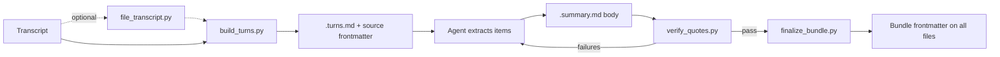

# px-summarize-transcript

Turns a meeting transcript into an evidence-backed bundle: a turn index, a summary report, and frontmatter that links every file together. Every decision, statement, action item, and open question cites the speaker, time, and a verbatim quote.

- **Command:** `/px-summarize-transcript <path to transcript or folder>` (add "for \<your name\>" for a personal view)
- **Agent instructions:** [SKILL.md](SKILL.md)
- **Version:** 2.3.0 (prodagenx, MIT)

## Supported inputs

| Input | Detected format | Timestamps |
|---|---|---|
| `.vtt` from Teams, Zoom, or Webex | `vtt` | yes |
| `.txt` or `.md` with a Teams copy/paste | `teams-paste` | yes |
| `.md` with `[Speaker] YYYY-MM-DD HH:MM:SS` lines | `md-bracket` | yes, as offsets from the first line |
| `.txt` or `.md` with `Name: text` lines | `speaker-lines` | no |

Details and samples: [references/input-formats.md](references/input-formats.md).

## The bundle

Everything is written next to the transcript, with the same file name and a different suffix. There is no option to write elsewhere.

```text
2026-10-09 261009-Solutioning.md                 source (frontmatter merged in place)
2026-10-09 261009-Solutioning.turns.md           turn index (built once)
2026-10-09 261009-Solutioning.summary.md         report
2026-10-09 261009-Solutioning.summary.v2.md      report from a later run
```

### What the sidecar is

Every file in a bundle carries a small header block (frontmatter) with the title, date, attendees, tags, and links to the other files. Markdown and text files can hold that header at the top.

A `.vtt` file can't. It has to start with the word `WEBVTT`, or players and tools stop reading it. So instead of editing the `.vtt`, the skill creates one extra small file next to it, `<stem>.source.md`, that holds the header for the `.vtt`. That extra file is the sidecar.

```text
261009-Solutioning.vtt          the transcript, never changed
261009-Solutioning.source.md    sidecar: the .vtt's header (title, date, attendees, tags, links)
261009-Solutioning.turns.md     turn index
261009-Solutioning.summary.md   report
```

Only `.vtt` sources get a sidecar. A `.md` or `.txt` source holds its own header.

All members share `bundle`, `title`, `tags`, `attendees`, meeting fields, and wikilinks to each other. Full key list and merge rules: [references/frontmatter-spec.md](references/frontmatter-spec.md).

## How a run works



1. Optional: `file_transcript.py` moves the transcript into a series folder such as `transcripts/weekly-standup/`. It never nests: a transcript that's already in a series folder stays put.
2. `build_turns.py` detects the format, builds the turn index if it doesn't exist yet, stamps the source, and prints the next summary path. It also reports the meeting date (from the transcript, frontmatter, or file name), gaps that suggest missing content, and the previous meeting's report in the same folder.
3. The agent reads the whole turn index and writes the report body using [references/report-template.md](references/report-template.md).
4. `verify_quotes.py` checks every citation: turn exists, speaker and time match, quote is in the turn, quote is 25 words or fewer. The agent fixes failures and re-runs it.
5. `finalize_bundle.py` stamps title, tags, people, speaker aliases, counts, and links on every bundle member.

## What the report contains

| Section | Purpose |
|---|---|
| Summary | Three to five sentences on purpose, key decisions, and the biggest risk |
| At a glance | Key decisions, action items grouped by owner, biggest risks, and what needs a human check |
| For \<Name\> | Optional personal view, only when you name the reader |
| Speakers | Each transcript label, the name shown in the report, and the evidence for the mapping (room devices, misspelled labels) |
| Decisions, Material statements, Action items, Open questions | The evidence tables. Every row cites a turn and a verbatim quote |
| Carried over | Status of the previous meeting's action items and open questions, when an earlier report exists in the same folder |
| Transcription caveats | Likely ASR errors, inferred speaker names, and gaps in the transcript |

## Recurring meetings

Keep each series in its own folder. When a new transcript's meeting date is later than an existing report in the same folder, the newest earlier report becomes the "previous meeting". The new report then gets a Carried over section and a `follows` link in its frontmatter. Each run still processes one transcript. Process a backlog oldest first so every report can find its predecessor.

## Scripts

All are standard-library Python (3.10+).

| Script | Purpose |
|---|---|
| `scripts/build_turns.py <transcript> [--rebuild] [--gap-minutes N]` | Parse, write `<stem>.turns.md` if missing, stamp source or sidecar, print JSON (date and its source, gaps, previous meeting) |
| `scripts/finalize_bundle.py <transcript> --title ... --tags ...` | Stamp shared frontmatter on all members. Options: `--summary`, `--alias "Label=Name"` (repeatable), `--attendee` (repeatable), `--attendees`, `--mentioned` (repeatable), `--meeting-date`, `--extraction-date` |
| `scripts/verify_quotes.py <summary>` | Check citations against the turn index. Exit 1 on failure. `--strict` fails long quotes too |
| `scripts/file_transcript.py <transcript> --series <name> [--root dir]` | Move a transcript and its bundle files into `<root>/<series>/`. Skips already-filed transcripts, reports duplicates and name conflicts. `--list` shows existing series, `--dry-run` previews |
| `scripts/scan.py <folder> [--recursive]` | List transcripts as `new`, `turns-only`, `summarized`, or `not-a-transcript` |
| `scripts/backfill.py <root> [--apply]` | Align legacy bundles: rename sources to the shared stem and fix links. Dry run by default |
| `scripts/parsers.py` | Format detection and the four parsers |
| `scripts/frontmatter.py` | Line-based frontmatter merge that never rewrites keys it doesn't own |
| `scripts/bundle.py` | Bundle paths, versioning, and stamping shared by the CLIs |

## Re-runs

- The turn index is built once by Python and is deterministic, so a re-run keeps it as-is (`turns_status: kept`). Turn IDs stay stable for every report version.
- If the transcript was edited after the turn index was built, `build_turns.py` stops with `turns_status: source-changed` and changes nothing. Pass `--rebuild` only if you want a new turn index; reports written against the old one will no longer verify.
- A new report goes to `.summary.v2.md`, `.v3`, and so on. Its `supersedes` key links the previous version.
- `verify_quotes.py` warns if a report's `turns-sha256` no longer matches the turn index.

## Quality checks

- Every row has at least one citation, and `verify_quotes.py` reports 0 failures.
- Every speaker label is in the Speakers table, with evidence for any renamed label.
- No owner is named without explicit, volunteered, delegated, or explained inferred evidence.
- `Agreed` decisions show an acceptance signal.
- Owners not in the meeting are marked `(not present)`.
- Likely ASR errors and transcript gaps are listed under "Transcription caveats" and never corrected inside quotes.
